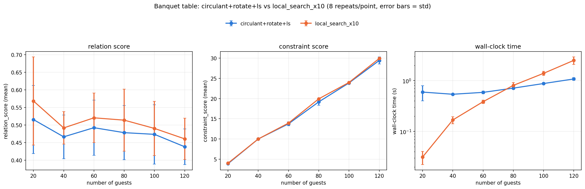
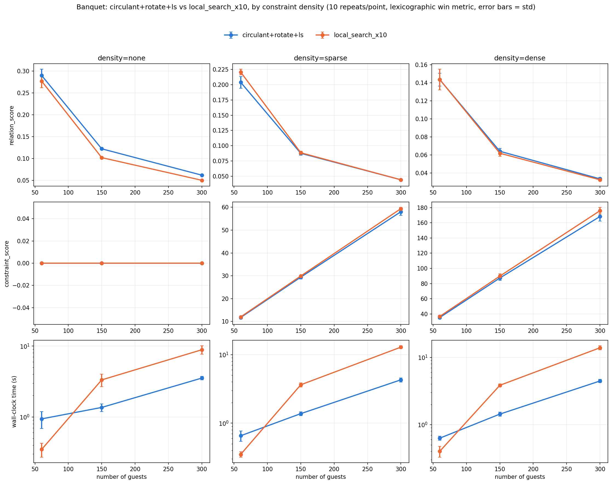

# Common Table

A seating planner for weddings, conferences and dinners. You give it a guest
list, say how the room is laid out, and it proposes an arrangement that puts
people who belong together near each other and keeps apart the ones who don't.

Live at **[commontable.org.uk](https://www.commontable.org.uk)**. Free, with no
account, and nothing stored on the server.



## Method

Seating is modelled as an assignment problem. Every pair of guests gets a score
saying how much they would like to be near each other, every pair of seats gets
a score saying how near they are, and the planner looks for the assignment of
guests to seats that maximises the sum of the products.

### Who wants to sit together

Two inputs feed the guest-pair score.

**Tags** describe a group a guest belongs to, such as a side of the family, a
department or a shared interest. If a tag is shared by `C` guests, it adds
`1/(C - 1)` to the score of every pair that shares it. Dividing by the group
size matters: without it, one large group would outweigh every small one, and
the plan would cluster the big group perfectly while scattering everybody else.
A tag held by a single guest contributes nothing.

**Constraints** are the things tags cannot express, and they are weighted an
order of magnitude higher so they dominate:

| Constraint | Weight | Counted as satisfied when |
|---|---|---|
| `must_sit_together` | +10 | the two seats are directly adjacent |
| `could_sit_together` | +5 | the two seats are connected at all, so, on one table |
| `must_sit_apart` | −10 | the two seats are not connected, so, on different tables |

### Which seats count as near

Each table style defines its own seat adjacency, as a weighted graph rather than
a yes or no. On a banquet table, neighbouring seats score 1, the seat directly
opposite scores 0.75, and diagonally opposite scores 0.5, decaying with distance
down the table. Cabaret tables are circulant, every seat `k` places round the
circle scoring `2^(1-k)`. Theatre rows are independent of each other, so two
people in the same section but different rows are not "together" at all.

This is why `must_sit_together` means adjacent and not merely on the same table:
a family of five cannot all be adjacent, so asking for it would guarantee a
violation. Groups larger than a pair are expressed as a shared tag instead.

### Finding the arrangement

Two solvers, dispatched on the shape of the problem.

`local_search_x10` is a discrete hill-climb on pairwise seat swaps, from ten
random restarts, keeping the best. `circulant+rotate+ls` is a mean-field
relaxation: it learns a soft guest-to-seat probability matrix by gradient
descent, extracts a hard assignment with the Hungarian algorithm, tries every
rotation of each table, and finishes with a short hill-climb.

Why circulant? A factorial experiment varied three properties of the seat graph
independently: whether adjacency wraps around or stops at an open end, whether
edge weight decays monotonically with distance, and whether every distance is
connected or only a gapped subset. Only the first mattered. At 200 guests every
wrap-around variant won 8 out of 8 against local search, and every open-ended
one lost 8 out of 8, whatever the other two were doing. Cabaret tables wrap
around naturally. Banquet and theatre do not, so they are trained against a
circulant surrogate and rotated back onto the real seats.

```
has_cabaret            -> circulant+rotate+ls
n_guests >= 300        -> circulant+rotate+ls
otherwise              -> local_search_x10
```

Requests are capped at 120 guests and 120 seats.

## Results

Measured by `backend/scripts/`, 8 to 10 repeats per point, scoring on the same
lexicographic metric the API returns.

| Style | Guests | Tag structure | circulant+rotate+ls vs local_search_x10 |
|---|---|---|---|
| Banquet | 300 | single-tag | 10 wins, 0 ties, 0 losses |
| Banquet | 300 | multi-tag | 8 wins, 0 ties, 2 losses |
| Banquet | 500 | multi-tag | 7 wins, 0 ties, 3 losses |
| Theatre | 150 (165 seats) | multi-tag | 10 wins, 0 ties, 0 losses |
| Theatre | 300 (315 seats) | multi-tag | 10 wins, 0 ties, 0 losses |
| Cabaret | all tested | all tested | no losing case found |
| Banquet | 20 to 120 | mixed, with constraints | local search wins on every count |

Three findings shaped the dispatch above.

**The gradient method is not a free win.** Below roughly 60 guests it is both
slower and worse: its fixed 1000-epoch training cost dominates at a size where
hill-climbing converges almost immediately. The production threshold sits at 300
for that reason, well above a typical wedding.

**At scale the win is speed, not quality.** Once realistic constraints are
present, the two methods are statistically tied on score, while
`circulant+rotate+ls` runs 2 to 3 times faster by n=300, and the gap widens.

**Overlapping tags erode the advantage.** Benchmarks using one clique tag per
guest overstate it. Real guest lists have cross-cutting affiliations, and under
those the 10/0/0 at n=300 becomes 8/0/2.



The long-form write-up, including the approaches that were tried and abandoned,
is in [backend/scripts/FINDINGS.md](backend/scripts/FINDINGS.md).

## Running it

Two services. The API is FastAPI on Python, the site is Next.js.

### API

```bash
python -m venv venv && source venv/bin/activate
pip install -r requirements.txt
cd backend
ALLOWED_ORIGINS=http://localhost:3000 uvicorn app.main:app --port 8000
```

### Site

```bash
cd frontend
npm install
NEXT_PUBLIC_API_URL=http://localhost:8000 npm run dev
```

Open <http://localhost:3000>. Use `localhost` rather than `127.0.0.1`: Next
rejects dev requests from other origins and will refuse to serve its own
JavaScript.

`ALLOWED_ORIGINS` is a comma-separated list the API matches exactly against the
browser's `Origin` header, so it has to name the port the site is served on.

### Tests

```bash
python -m pytest backend/tests        # solver and schema unit tests
cd frontend && npx tsc --noEmit && npx eslint app components lib
```

## Endpoints

| Method | Path | Purpose |
|---|---|---|
| `POST` | `/api/v1/optimise` | Produce a seating plan |
| `POST` | `/api/v1/optimise/shuffle` | Re-run with a shuffled scan order for a different arrangement |
| `POST` | `/api/v1/evaluate` | Score an arrangement edited by hand, without re-optimising |
| `POST` | `/api/v1/feedback` | Record whether the plan was useful |

## Layout

```
backend/app/       FastAPI service: schema, solvers, dispatch
backend/scripts/   Benchmarks and the research write-up
backend/tests/     Unit tests
frontend/          Next.js site
frontend/lib/      Guest list import, spreadsheet column detection
logic/             Original standalone implementation, kept for reference
```

## Licence

MIT. See [LICENSE](LICENSE).
