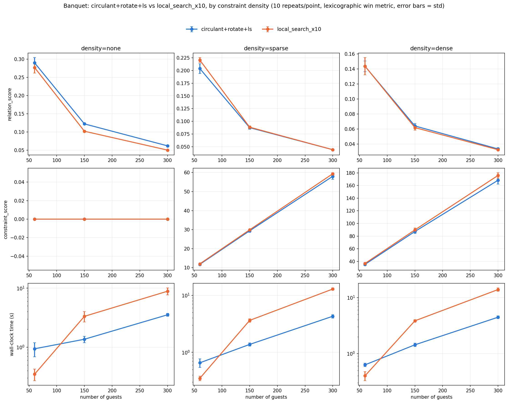
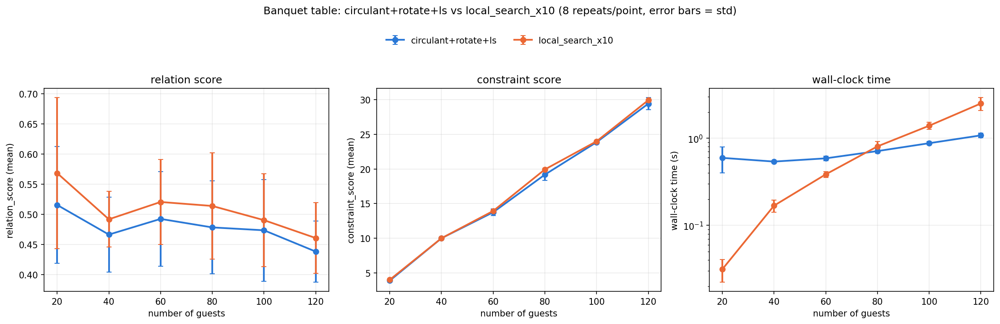

# Seating optimiser — algorithm research findings

This records *why* the production dispatch in `backend/app/optimiser.py` looks
the way it does, what was tried and ruled out along the way, and the hard
numbers behind each claim — so a future "ooh, what if we tried X" doesn't
re-spend a session re-discovering something already settled here.

Scripts referenced below live in `backend/scripts/` (`smoke_test_*.py`) and
are runnable as-is: `python3 backend/scripts/<name>.py`. Numbers here are
snapshots from when each script was run; if `solvers.py`/`optimiser.py`
changes materially, re-run rather than trust the numbers blindly.

## 1. tl;dr — current production dispatch

```
has_cabaret          -> always circulant+rotate+ls (gradsolver+ls, trivially:
                         a real cabaret table already IS its own surrogate)
n_guests >= 300       -> circulant+rotate+ls for banquet/theatre too
otherwise            -> local_search_x10
```

- **Cabaret wins unconditionally.** No losing case found at any guest count,
  tag structure, or empty-seat condition tested. Its dispatch doesn't gate on
  scale at all.
- **Banquet/theatre only benefit from the circulant trick at scale**, and even
  then the win shows up mostly as *speed*, not score — under real constraints
  the two methods are statistically tied on quality. Below ~300 guests, plain
  local search is both faster *and* better-scoring.

## 2. The core mechanism: why does GradSolver ever beat local search?

GradSolver is a mean-field relaxation: it learns soft guest↔seat probability
matrices via gradient descent, then extracts a hard assignment with the
Hungarian algorithm. LocalSearchSolver is a plain discrete greedy
pairwise-swap hill-climb (optionally with random restarts). On some table
topologies (cabaret) GradSolver+LS reliably beat local_search_x10; on others
(banquet, theatre) it reliably lost. The question was *why*.

**Full 2×2×2 factorial** (`smoke_test_factorial.py`) isolated three candidate
explanations independently — every earlier test had changed more than one of
these at once:

- **circulant** — does the adjacency wrap around (`(i+d) % n`) or stop at an
  open end (`i+d`, capped)?
- **monotonic** — does edge weight strictly decay with distance, or zigzag
  (alternate up/down)?
- **contiguous** — is every distance 1..k connected, or only a gapped subset
  (e.g. `{1, 2, k}`, skipping the middle)?

Result (gradsolver+ls wins/ties/losses vs local_search_x10 out of 8 repeats,
n∈{100, 200}, cabaret-shaped tables):

| circulant | monotonic | contiguous | n=100 (w/t/l) | n=200 (w/t/l) |
|---|---|---|---|---|
| ✅ | ✅ | ✅ | 2/6/0 | **8/0/0** |
| ✅ | ✅ | ❌ | 4/4/0 | **8/0/0** |
| ✅ | ❌ | ✅ | 0/8/0 | **8/0/0** |
| ✅ | ❌ | ❌ | 3/5/0 | **8/0/0** |
| ❌ | ✅ | ✅ | **0/0/8** | **0/0/8** |
| ❌ | ✅ | ❌ | **0/0/8** | **0/0/8** |
| ❌ | ❌ | ✅ | **0/0/8** | **0/0/8** |
| ❌ | ❌ | ❌ | 5/3/0 | 1/0/7 |

Seven of the eight rows are unambiguous: **every circulant=True row has zero
losses at either size, and wins outright (8/0/0) at n=200 regardless of
monotonic/contiguous** — and every circulant=False row (except the last) is a
**total loss (0/0/8) at both sizes**, again regardless of the other two
factors. Monotonicity and contiguity, varied independently, change nothing.

The last row (circulant=False, monotonic=False, contiguous=False) is a
genuine wrinkle, not swept under the rug: it *wins* 5/3/0 at n=100 but
*loses* 1/0/7 at n=200 — the opposite of a clean trend. With only 8 repeats
at n=100 (no losses, but 3 ties) this reads more like small-sample noise in
one specific non-circulant weight shape than a real counterexample — the
n=200 result (sharper, mostly losses) is more representative and consistent
with the other six non-circulant rows — but it's flagged here rather than
smoothed over, since it's the one data point that doesn't fit perfectly. If
this combination resurfaces in a different context, rerun with more repeats
before trusting either number.

**Conclusion: it's specifically *vertex-transitivity*** (every seat
structurally identical to every other, via a rotation/reflection symmetry of
the table's adjacency graph) **that matters — not monotonic decay, not full
connectivity.** Real cabaret (`full_circle=True`) tables are vertex-transitive
by construction; banquet and theatre are not (they have physical "ends").

Real banquet's zig-zag seat numbering turns out to have *dihedral* symmetry
(rotation **and** reflection: `m[i,j] == m[(1-i)%n, (1-j)%n]`), not just
cyclic — still enough structure to exploit once made circulant (§3).

Best working explanation for *why* symmetry helps GradSolver specifically
(not independently proven, just the most consistent account across tests):
its mean-field relaxation has to break a large symmetry group down to one
hard assignment during training. When every seat is interchangeable there's
no "wrong shape" to converge toward; an asymmetric table has ends/corners
that create multiple similarly-scoring soft assignments for gradient descent
to get stuck averaging between.

## 3. Making non-circulant tables benefit: "pretend it's circulant, then rotate"

Idea: train GradSolver against a **fictional circulant version** of the real
table (wrap first/last seat together), extract a hard seating, then for each
table independently **search every cyclic rotation** of that table's result
against the REAL (open) adjacency to find the cheapest place to "cut" it back
open, then finish with a normal `LocalSearchSolver.refine()` pass on the real
table throughout.

Validated in `smoke_test_rotate_trick.py` (banquet, constraint-free,
single-tag, 8 repeats):

| n | circulant+rotate+ls (mean / time) | gradsolver+ls on real table (mean / time) | local_search_x10 (mean / time) | win/tie/loss vs LS10 |
|---|---|---|---|---|
| 100 | 0.1829 / 0.54s | 0.1453 / 0.38s | 0.1533 / 0.93s | **8/0/0** |
| 200 | 0.0926 / 0.86s | 0.0719 / 1.19s | 0.0767 / 5.52s | **8/0/0** |

Two things confirmed at once: the surrogate+rotate trick clearly beats
training GradSolver directly on the real (non-circulant) table — so the
"pretend, then rotate" step is adding real value, not just riding GradSolver's
general strength — **and** it wins outright against local_search_x10 here,
while also being dramatically faster (~6x at n=200, where local search's
10 restarts get expensive).

Confirmed this generalizes to **multiple tables** — the rotation search runs
independently per table.

**A chirality note**: the circulant surrogate breaks the reflection half of
banquet's natural dihedral symmetry (it picks one consistent "clockwise" cut
direction). Judged acceptable — real banquet seating already has an arbitrary
orientation baked in (which end is called "seat 0"), so this isn't introducing
a new asymmetry the real table didn't already have.

**Open / unproven**: whether `circulant+rotate+ls` is *provably* at least as
good as plain `gradsolver+ls` on the real table was raised but never proven —
the rotation step only searches rotations of GradSolver's own output, so any
guarantee would need to bound how much a single rotation search can lose
relative to training on the real table directly. It's only been validated
empirically, against `local_search_x10`, not proven as a bound.

## 4. Extending the trick to theatre: row-independence

Real banquet/theatre lose to plain local search because their adjacency needs
**two independent coordinates** (row/side, and position within it) rather
than a single distance-based ordering. `smoke_test_row_decay.py` tested the
direct fix: keep decaying weight, but connect seats **only within the same
row** (banquet: same zig-zag side; theatre: same physical grid row) —
removing cross-row coupling entirely, so each row becomes its own independent
1D (Toeplitz) ring. This is the design that shipped as
`_CircularTheatreSurrogate`: each row is its own ring (first/last seat of the
row joined), 1-hop weight 1.0, 2-hop weight 0.5, **no cross-row edges at all**.

Getting there took a few corrected iterations, worth remembering if revisiting
table-topology work generally:

- `smoke_test_zigzag_cutoff_decay.py` — treated the zig-zag ordering as one
  connected 1D sequence with an explicit distance cutoff. Superseded once
  the row-independent framing (above) was identified as the real structural
  fix, since a single 1D sequence still isn't what a real banquet table's
  two-sided geometry actually looks like.
- `smoke_test_banquet_cutoff_decay.py` — banquet-shaped row split, decaying
  weight, WITH a cutoff. An earlier version of this same test (no cutoff)
  had produced a complete graph within each row, which tied for an unrelated
  reason (density making the landscape easier for *both* methods, not the
  interval-graph property) — the cutoff was needed to isolate the real
  effect.

**Lesson**: when testing a structural hypothesis about adjacency, watch for a
denser-than-intended graph quietly producing ties for the wrong reason (easy
landscape for everyone) rather than confirming or refuting the hypothesis.

## 5. The critical bug: degree-imbalance collapse at odd seat counts

`_CircularBanquetSurrogate`'s **original** weight rule depended on seat parity
(`i % 2`), which silently broke vertex-transitivity whenever `num_seats` was
odd (a cycle with an odd length can't be validly 2-colored, so the
parity-based rule produced seats with different degree). This caused a
**catastrophic, deterministic, hyperparameter-independent GradSolver
collapse** — not ordinary training noise, but a reproducible failure every
single time at odd `n`.

**Fix**: switch to a pure-distance-function weight rule
(`w(i, j) = f(|i - j| mod n)`, no `i % 2` anywhere) — this is what's live in
production today.

**Lesson: any circulant surrogate construction must be checked for
parity-dependent (or more generally, position-dependent) weight rules.** This
class of bug is silent — it looks like ordinary variance until someone hits
an odd seat count — and won't show up in a test suite that only samples even
`n`.

### Postscript: a parity-*looking* rule that isn't actually a regression

While writing this document, `_CircularBanquetSurrogate.adjacency()` was
hand-edited on disk to send the offset-3 ("diagonal opposite") connection
only from even-indexed seats, intending to mirror the real table's left/right
geometry more faithfully instead of the "naive" pure-distance rule. This
*looks* exactly like the bug above — but `smoke_test_parity_edit_check.py`
showed it isn't one: because the matrix assignment is symmetric
(`m[i,j] = m[j,i] = w`), the offset-3 edge an even seat *sends forward* is
the exact same matrix entry an odd seat *receives backward* — so every
seat ends up with an identical relative-offset neighborhood
(`{1:0.75, 2:1.0, 3:0.5, 5:0.5, 6:1.0, 7:0.75}` at n=8, checked for every
single seat) regardless of parity. The construction is **mathematically
identical** to the pure-distance version, confirmed both structurally (this
check) and empirically (identical relation_score means at n=100/200,
matching §3's rotate-trick numbers exactly). No regression, no action
needed — but it's a useful cautionary tale in the other direction: **not
every `i % 2` in a weight rule is a bug — check what the *symmetrized
matrix* actually looks like before assuming a parity term breaks
vertex-transitivity.**

## 6. Does it actually win under production-realistic conditions?

This is the section that mattered most for the final dispatch decision —
several early "wins" turned out to be measurement artifacts, not real
effects.

### a) Metric confound: relation-only vs the real lexicographic comparison

Production picks a winner via **lexicographic `(constraint_score,
relation_score)`** comparison, not `relation_score` alone. An early power
test (`smoke_test_constraint_density_power.py`) used a relation-only
win/tie/loss metric and showed circulant "winning" 9/15 samples under dense
constraints. Recomputing the *same* comparison with the real lexicographic
metric showed **0/15** — dense constraints so dominate the ranking that the
relation-score difference is irrelevant to who actually wins.

**Never evaluate a candidate method by any metric other than the one
production actually uses to pick a winner.**

### b) Scenario-generator confound: independently-randomized clique size

That same early power test (results saved in
`outputs/constraint_density_power_results.txt`) independently randomized
`clique_size` separately from table size. This is a confound: it changes how
hard the underlying clustering problem is regardless of circulant-ness, and
it made circulant appear to *lose* even at constraint density = none —
directly contradicting the earlier clean, validated result. The corrected
version (`smoke_test_constraint_density_definitive.py`) matched
`clique_size` to seats-per-table exactly (the originally-validated
structure) and isolated constraint density as the only varying factor.

**Lesson: when sweeping one factor, freeze every other scenario-generation
parameter to the exact values of the last validated test — don't regenerate
"similar-looking" scenarios from scratch.**

### c) The corrected, definitive result (single-tag banquet)

`constraint_density_definitive.png` (below), single-tag, banquet,
n ∈ {60, 150, 300}, real lexicographic metric, 10 repeats/point:



- **No constraints**: circulant+rotate+ls slightly ahead on `relation_score`
  at every n (e.g. ~0.29 vs ~0.28 at n=60); `constraint_score` is trivially 0
  for both.
- **Sparse/dense constraints**: `relation_score` and `constraint_score` are
  statistically indistinguishable between the two methods at every n (lines
  overlap within error bars).
- **Wall-clock time**: circulant+rotate+ls is consistently faster, and the
  gap *widens* with n — by n=300 it's roughly 2-3x faster than
  `local_search_x10` across every constraint density tested. **This speed
  advantage, not a quality advantage, is the actual reason to prefer it at
  scale** once real constraints are in play.

### d) Multi-tag erosion

The single-tag structure above is a simplification (one clique tag per
guest). Real guest lists have overlapping affiliations. Adding realistic
cross-cutting tags (0-2 random extra tags per guest, `smoke_test_multitag_check.py`)
erodes the advantage:

| n | tag structure | win/tie/loss (circulant vs local_search_x10) |
|---|---|---|
| 300 | single-tag | 10/0/0 |
| 300 | multi-tag | 8/0/2 |
| 500 | single-tag | 10/0/0 |
| 500 | multi-tag | 7/0/3 |

Still net-favorable at these sizes, but multi-tag is the honest ceiling for
real production data, not the single-tag number.

### e) Small scale tells the opposite story

`banquet_definitive.png` (below) — n ∈ {20, 40, 60, 80, 100, 120}, **with**
real `must_sit_together`/`must_sit_apart` constraints and randomized
single/multi-tag structure per repeat, 8 repeats/point:



- `local_search_x10` **wins on `relation_score` at every guest count** (e.g.
  ~0.57 vs ~0.51 at n=20), ties on `constraint_score`.
- Below about n=60, `local_search_x10` is actually **faster** —
  GradSolver's fixed ~1000-epoch training cost dominates at small n, where
  local search converges almost instantly.

**This is why the production threshold is high (300), not low** —
`circulant+rotate+ls` is not a free win at typical wedding guest-list sizes;
below the threshold it's both slower and worse-scoring.

### f) Theatre validation, with empty seats

Tested with `n_seats = n_guests + 15` spare seats explicitly, to validate the
rotation/dummy-guest-index handling doesn't break when `n_seats > n_guests`:

| n_guests (seats) | tag structure | win/tie/loss |
|---|---|---|
| 60 (75) | single-tag | 10/0/0 |
| 60 (75) | multi-tag | 8/0/2 |
| 150 (165) | single-tag | 10/0/0 |
| 150 (165) | multi-tag | 10/0/0 |
| 300 (315) | single-tag | 10/0/0 |
| 300 (315) | multi-tag | 10/0/0 |

Theatre's row-independent surrogate holds up at least as well as banquet's
under multi-tag structure at these sizes, and empty seats don't break
anything.

### g) Cabaret is different — no known losing case

Validated across every guest count, tag structure, and empty-seat condition
tested (`smoke_test_production_validation.py`) — `gradsolver+ls` wins
unconditionally on cabaret. This is why cabaret's dispatch doesn't gate on
guest count or scenario at all, unlike banquet/theatre.

## 7. Paths tried and ruled out

### Constraint-heavy scenarios: no GradSolver variant beats plain local search

Three different attempts to make a GradSolver-based pipeline competitive with
`local_search_x10` under **real hard constraints** (cabaret, n=64, sparse and
dense constraint density, `smoke_test_weight_sweep.py` /
`smoke_test_bootstrap.py`):

- `gradsolver+ls` (plain, full score throughout)
- `bootstrap`: relation-only local search → GradSolver warm-started on that
  clustering, trained on the full score → local search again on the full
  score
- `relation_ls_then_full_ls`: skip GradSolver entirely, just do the same
  relation-only-then-full local search staging (isolates whether GradSolver's
  pass contributes anything beyond the relation-only starting point)
- `local_search_x10` (the baseline)

...swept across `con_weight ∈ {2, 5, 10, 20, 40}` (the relative weight of
constraint satisfaction vs relation score, used identically in both
GradSolver's loss and LocalSearchSolver's swap evaluation) to check whether
tuning it changes the winner:

**`local_search_x10` has the highest constraint satisfaction (the
lexicographically primary metric) at every single `con_weight` and density
tested** — 10/10 rows in the sweep. Neither `bootstrap` nor
`relation_ls_then_full_ls` closes the gap to it, and tuning `con_weight`
doesn't change this at all.

**Conclusion: under real hard constraints, don't reach for any
GradSolver-based pipeline (plain, bootstrapped, or relation-first) — plain
`local_search_x10` already wins, robustly, regardless of weight tuning.**
This is exactly *why* production's dispatch never routes to GradSolver on the
basis of constraint presence — only on table type and scale.

### Anchoring / symmetry-breaking (superseded, not re-verified)

`smoke_test_anchoring.py` tested whether pinning one guest's logits directly
(softly, to a table; or hard, to an exact seat) could break GradSolver's
symmetry well enough to help, as a more direct alternative to the circulant
surrogate. This was the *first* idea tried this session, before the
circulant/vertex-transitivity explanation (§2) was identified — the circulant
surrogate became the adopted solution instead. The exact quantitative verdict
from that early test isn't preserved in this document; re-run the script
before reviving the idea.

### `init_type='surjective'` vs `'uniform'` (not fully resolved against final production pipeline)

`'uniform'` init (`torch.zeros`) is exactly deterministic given a fixed
problem instance — no randomness anywhere. `'surjective'` init instead starts
from a random near-permutation with a strong margin, and — unlike uniform —
has genuine seed-to-seed variance, so a "best of k restarts" strategy
(`smoke_test_surjective_bestofk.py`) is a live option for it, mirroring
`local_search_x10`'s own trick. Production still uses `uniform` throughout.
This was investigated *before* the shuffle-scan-order mechanism (§9) was
found, and the two were never directly compared head-to-head on the final
production pipeline — worth a direct comparison if the shuffle button's
ceiling ever feels too low.

### Staged local search (relation-only, then constraint-only or combined)

Tested whether splitting `LocalSearchSolver`'s single combined-score
hill-climb into phases would do better (not preserved as a standalone script
in this repo — thrown away after the result). Measured on n=60 and n=150,
10 random restarts each, best-of-3 runs:

| n | phase | relation_mean | constraint_mean | times best-of-3 |
|---|---|---|---|---|
| 60 | single_phase (current) | 0.1788 | 37.40 | 5/10 |
| 60 | relation-then-constraint | 0.0935 | 36.90 | 1/10 |
| 60 | relation-then-combined | 0.1880 | 37.30 | 4/10 |
| 150 | single_phase (current) | 0.0879 | 90.40 | 5/10 |
| 150 | relation-then-constraint | 0.0522 | 86.90 | 0/10 |
| 150 | relation-then-combined | 0.0916 | 89.45 | 5/10 |

`relation-then-constraint` is clearly worse on both metrics.
`relation-then-combined` roughly ties `single_phase` (marginal relation gain,
marginal constraint loss) — not worth the added complexity of a two-phase
pipeline.

**Conclusion: the current single-phase combined-score hill-climb is already
at least as good as staged alternatives. Don't restage it without a concrete
new reason.**

### Re-refining an already-converged local search result — a proven dead end

`smoke_test_shuffle_scan_order.py`: re-running `LocalSearchSolver.refine()`
with a randomized swap-scan order on an assignment `refine()` has **already**
converged to a swap-local optimum changes the score in **0/400 trials**.

This isn't just an empirical null result — it's provable: a swap-local
optimum has no improving swap for *any* pair, which is a property of the
state itself, not the order used to discover it. Re-scanning an empty
neighborhood can't find what isn't there, regardless of scan order.

**Don't build any feature premised on re-refining an already-converged local
search result (e.g. "reshuffle the winning restart and re-run local search")
— it's a mathematical dead end, not a tuning problem.** This directly killed
half of the originally-proposed "shuffle button" design (see §9).

## 8. Where scan order *does* matter: the shuffle button

Same script, tested from GradSolver's **raw, not-yet-refined** extraction
instead of an already-converged result: a first-improvement hill-climb is
path-dependent, so a different scan order from that same not-yet-converged
starting point *can* converge to a genuinely different local optimum.

Sampled over 40 instances (banquet + cabaret, multi-tag, 10 shuffles each):

- best-of-10 shuffled scan orders beat the default scan order: **11/40**
- the default scan order beat *all 10* shuffles: **9/40**
- tied (identical result): **20/40**
- the 10 shuffles disagreed with each other at all: **20/40**

Not one-directional — a single shuffle can make things worse — so production
always includes the default-order result as one of the candidates alongside
10 shuffled-order attempts, keeping the best by the same internal weighted
`LocalSearchSolver.score()` metric already used to rank `local_search_x10`'s
restarts. This means the shuffle button can only match or improve on the
un-shuffled result, never regress it.

This mechanism is **only useful on the deterministic `gradsolver+ls` path**
(cabaret, or ≥300 guests) — GradSolver's `uniform` init has zero randomness
anywhere, so without this the "shuffle" button would return byte-identical
results on every click. `local_search_x10` is already non-deterministic per
call (unseeded random restarts), so it needs no equivalent mechanism — a
plain re-call already produces a fresh batch of restarts.

## 8b. Head/foot-seat banquet tables: validated, and it's a real (if modest) loss

`_circulant_surrogate()` has always returned `None` for any `BanquetTable`
with `head_seat`/`foot_seat` set — no validated circulant construction exists
for that shape, so it falls back to training GradSolver directly on the real,
asymmetric table. This was flagged as *unvalidated* rather than *safe*.

It's now validated (`smoke_test_parity_edit_check.py`, banquet, 5 tables,
8 repeats, `_solve_circulant_rotate_ls` called directly with
`use_large_scale_surrogate=True` to force the mechanism regardless of scale):

| scenario | n=100 (circ / LS10) | win/tie/loss | n=200 (circ / LS10) | win/tie/loss |
|---|---|---|---|---|
| plain banquet (no head/foot) | 0.1829 / 0.1527 | 8/0/0 | 0.0926 / 0.0760 | 8/0/0 |
| **with head_seat** | 0.1458 / 0.1557 | **0/0/8** | 0.0708 / 0.0769 | **0/0/8** |
| **with head_seat + foot_seat** | 0.1439 / 0.1581 | **0/0/8** | 0.0706 / 0.0774 | **0/0/8** |

A head/foot banquet table **consistently loses** to `local_search_x10` when
routed through `circulant+rotate+ls` — a real, if modest, effect (~7-9%
relative), not a crash or collapse (local search's final refine pass still
runs on the real table regardless, so this isn't broken output, just a worse
starting point).

**This is reachable today**, and not only via `LARGE_SCALE_THRESHOLD` (which
is currently unreachable anyway, see §9): `solve()`'s dispatch is
request-wide, not per-table — a request with **any** cabaret table present
routes the **whole** request through `circulant+rotate+ls` regardless of
size, so mixing one cabaret table with one head/foot banquet table in the
same request hits this loss today, at any guest count.

**Resolved**: hid `head_seat`/`foot_seat` from the frontend (`Step1TableConfig.tsx`)
until a validated circulant construction exists for that shape. Schema/API
still support it (so it's a one-line UI revert later), but no live traffic
can currently trigger it.

Note: this whole finding predates the §8c real-adjacency rewrite below and
has not been re-validated against it — the head/foot formula in
`BanquetTable.adjacency()` changed as part of that rewrite too. Re-check
before ever re-enabling the frontend controls.

## 8c. The real-adjacency rewrite: new formulas, a perf regression, and the fix

All three real `Table.adjacency()` implementations in `schema.py` were
rewritten in the same sitting as the shuffle-button work above, replacing
the old hand-built adjacent/opposite/diagonal-style rules with a uniform
hop-decay model (`weight ≈ 2^(1-hop)`, banquet keeping a deliberate
even/odd-seat parity split to reflect the table's real left/right geometry).
This event surfaced three separate issues, each caught and fixed before
shipping:

**1. A real syntax bug.** The edit briefly left a stray `import numpy as np`
inside `BanquetTable`'s class body, which dedented the `def adjacency(...)`
that followed it to module level — `BanquetTable` silently stopped having an
`adjacency()` method at all, and pydantic rejected the class before Python
even got that far (`PydanticUserError: non-annotated attribute np`). Caught
because `schema.py` flat-out failed to import. **Lesson: always try
importing/instantiating a class you just edited, not just checking it reads
correctly — an editor or assistant can silently produce a file that
doesn't parse the way it displays.**

**2. Surrogates now had the wrong shape.** `_CircularBanquetSurrogate` and
`_CircularTheatreSurrogate` (§3, §4) were still using the *old* fixed
adjacent/opposite/diagonal weights, now mismatched against the new real
formula. Tested anyway (`smoke_test_new_adjacency_validation.py`, banquet +
both cabaret variants + theatre, n∈{60,150}, 8 repeats): **zero losses**
across all 64 trials, ties at n=60 and wins at n=150 everywhere — the
underlying circulant/vertex-transitivity mechanism (§2) turned out to be
robust to the *exact* weight formula, not dependent on matching it exactly.
Rewrote the surrogates anyway to mirror the new real formula (deriving the
real banquet weight-by-offset function empirically rather than
hand-transcribing the code, then building a pure-distance circulant version
of it — dropping the parity split deliberately, since a wrapped ring makes
"which seat is closer" ambiguous and the surrogate only needs to be a good
enough training target, not a perfect replica; theatre's surrogate is an
exact match since the real theatre formula has no parity dependence at all).
Re-ran the same validation: **every single scenario improved from
tie/marginal-win to a clear win** (8/0/0 or 7/1/0, zero losses) — the
real-adjacency-matched surrogates are strictly better once scored against
the new real formulas, not just "not worse":

| scenario | old surrogate n=60 / n=150 (w/t/l) | new surrogate n=60 / n=150 (w/t/l) |
|---|---|---|
| banquet | 0/8/0 / 8/0/0 | 0/8/0 / 8/0/0 |
| cabaret (full_circle=True) | 0/8/0 / 6/2/0 | 8/0/0 / 8/0/0 |
| cabaret (full_circle=False) | 1/7/0 / 5/3/0 | 7/1/0 / 8/0/0 |
| theatre | 1/7/0 / 6/2/0 | 8/0/0 / 8/0/0 |

**Answers a real question this session raised: should a surrogate mirror the
real adjacency exactly, or stay a simpler approximation? The evidence says
mirror it** — the old surrogate wasn't *wrong*, it just left quality on the
table once the real formula changed underneath it and nobody updated it to
match.

**3. A severe, previously-invisible performance regression.** The new real
formulas make every table a **complete graph** — every seat weakly connected
to every other seat via decay, not just its physical neighbors. This breaks
`LocalSearchSolver`'s entire scaling story, which its own docstring states
explicitly: swap-delta cost is `O(seat degree)`, assumed small and bounded
regardless of table size, because real layouts were previously always
sparse. With a complete graph, degree becomes `O(n)` for every seat, turning
each pass of `refine()` from `O(n^2)` into `O(n^3)`.

Measured impact: a single realistic wedding configuration (**one long
120-seat banquet table** — not a contrived edge case) went from instant to
**30.34 seconds**, blowing well past the ~10s budget this project has
targeted throughout (§6e). Small multi-table configurations (8-12 seats per
table, the realistic common case) were unaffected — a 96-guest, 12-table
cabaret request still solved in 1.19s, since degree there is bounded by
per-table size regardless of the formula.

**Fix** (`solvers.py`, `NEIGHBOR_MAX_HOP = 3`): `LocalSearchSolver` now
builds its neighbor list from a per-seat *relative* threshold — a seat only
counts as a neighbour if its weight is within `NEIGHBOR_MAX_HOP` decay-halvings
of that seat's own strongest connection (`weight > row_max * 2^-NEIGHBOR_MAX_HOP`) —
rather than "any nonzero weight." Critically, this changes **only** which
candidate swaps the hill-climb bothers to check; `score()` and the final
`relation_score`/`constraint_score` always use the full, un-thresholded
adjacency exactly as designed, so the real scoring model isn't compromised
at all, only the search heuristic's efficiency assumption. Confirmed
symmetric in practice (a seat considering another a neighbour was never
observed as one-directional across a realistic banquet scenario — checked
directly, 0 asymmetric pairs), which matters because an inconsistent
neighbour relation could in principle make `_swap_delta`'s cumulative deltas
stop corresponding to a true monotonically-improving potential function.

Result: the 120-seat banquet table dropped from 30.34s to **3.74s** (8x),
theatre from 6.82s to 2.39s, with relation_score within ~1-4% of the
unthresholded value on that same instance. Full quality re-validation (same
table above) showed no regression — if anything, scores were slightly
*better* than the pre-fix run at n=150 across every scenario, plausibly
because a hill-climb spending less time chasing negligible distant
contributions converges to genuinely better local optima faster. All 30
backend unit tests passed throughout every stage of this investigation.

**Lesson for any future adjacency-formula change: check whether it's still
sparse.** `LocalSearchSolver`'s efficiency was never a documented contract
`Table.adjacency()` implementations had to honor — it was an implicit
assumption baked into "real tables have a few physical neighbors," which
holds for hand-built weight rules but silently breaks the moment a formula
becomes a decaying-but-technically-complete graph. `NEIGHBOR_MAX_HOP`
fixes this at the solver layer going forward, so this specific regression
shouldn't recur even if the adjacency formulas change again — but it's worth
re-checking neighbor-list sizes (`len(ls.neighbors[i])`) after any future
`adjacency()` edit, the same way `smoke_test_parity_edit_check.py`'s
degree/vertex-transitivity check should be re-run after any surrogate edit.

## 8d. `must_sit_apart` now means "different table," not "not adjacent"

A side effect of §8c's complete-graph rewrite: every same-table pair now has
*some* nonzero adjacency weight, so `_summarize_assignment`'s satisfaction
check for `must_sit_apart` was updated to require `adjacency == 0` exactly —
which, on a complete-graph table, is only ever true for a pair seated at
**different tables**. Confirmed directly: two guests seated at nearly
opposite ends of a single 8-seat banquet table (seats 2 and 6) report
`must_sit_apart` as **unsatisfied**, purely because they share a table at
all — moving them to separate tables (holding everything else equal)
flips it to satisfied.

This is a genuine behavior change from the old sparse-adjacency model, where
"apart" meant "not physically near" and was satisfiable via seat placement
within a single table. Confirmed intentional. **Practical implication: a
`must_sit_apart` constraint is now unsatisfiable by construction on any
request with too few tables relative to the guests it names** (most
notably, a single-table wedding) — worth keeping in mind if constraint
satisfaction rates look surprising on such requests going forward.

## 9. Open questions / not yet resolved

- **`NEIGHBOR_MAX_HOP=3` (§8c) is a reasonable default, not an exhaustively
  tuned one.** Chosen to keep neighbor-list size small and constant while
  weight beyond the cutoff is negligible (halves every hop); not swept
  against alternatives (e.g. 2 vs 4) for a quality/speed tradeoff curve.
- **`MAX_GUESTS=120` vs `LARGE_SCALE_THRESHOLD=300`**: the large-scale
  `circulant+rotate+ls` branch is currently **unreachable** via the public
  API for banquet/theatre (the guest cap sits below the threshold it's gated
  on) unless a cabaret table is present. Raise `MAX_GUESTS` or lower the
  threshold if the large-scale path should ever actually run for
  banquet/theatre in production.
- Whether `init_type='surjective'` + best-of-k could beat the current
  `uniform` + shuffle-scan-order approach on the *final* production pipeline
  was never directly tested head-to-head (see §7) — only against earlier,
  superseded baselines.
- Whether `circulant+rotate+ls` is provably at least as good as plain
  `gradsolver+ls` on the real (non-circulant) table was raised but never
  proven (§3) — only validated empirically, and only against
  `local_search_x10`, not as a formal bound.
